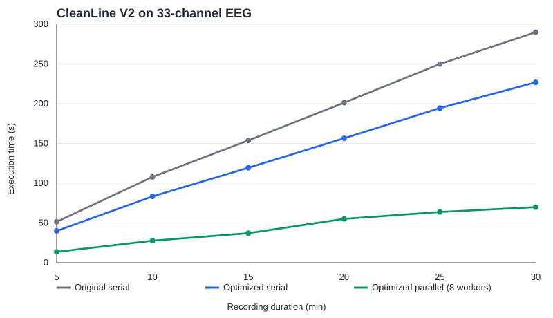

# CleanLine GPT-6 Optimized — development benchmark and licensing review

**Development status:** The full EEGLAB plugin is **not released**. Its local
prototype passed the checks described below, but the redistribution license
for the copied CleanLine V2 core has not been established. This branch contains
new wrapper code and benchmark documentation only; it is not an installation ZIP.

**5-minute recording — Original CleanLine: 51.47 s → Optimized CleanLine:
13.69 s (3.8× faster; 73.4% reduction in execution time).**

**30-minute recording — Original CleanLine: 289.94 s → Optimized CleanLine:
69.94 s (4.1× faster; 75.9% reduction in execution time).**

These are medians of three measured runs on the same 33-channel EEG data.
The headline compares the usual serial baseline with the eight-worker
optimized mode. The source change alone also improves matched parallel
execution: **15.28 → 13.69 s at 5 min (1.12×)** and **80.43 → 69.94 s at
30 min (1.15×)**. The optimized serial mode takes 40.00 s and 226.85 s at
those durations, respectively.
Speedup = Original time / Optimized time; time reduction (%) =
100 × (Original time − Optimized time) / Original time.

## Total execution time

| Duration | Original (s) | Optimized Serial (s) | Optimized Parallel (s) | Serial speedup | Parallel speedup |
| --- | ---: | ---: | ---: | ---: | ---: |
| 5 min | 51.47 | 40.00 | 13.69 | 1.29× | 3.76× |
| 10 min | 107.91 | 83.39 | 27.64 | 1.29× | 3.90× |
| 15 min | 153.75 | 119.38 | 37.16 | 1.29× | 4.14× |
| 20 min | 201.33 | 156.47 | 55.11 | 1.29× | 3.65× |
| 25 min | 249.89 | 194.53 | 63.80 | 1.28× | 3.92× |
| 30 min | 289.94 | 226.85 | 69.94 | 1.28× | 4.15× |

“Original” means the original computation with a native serial `for` loop.
Serial speedup = Original serial / Optimized serial; parallel speedup =
Original serial / Optimized parallel. Both implementations were measured
with the same execution mode for source-only comparisons, recorded in the
[aggregate log](benchmarks/timing.csv). The 5- and 30-minute serial results
are medians of three runs; the intermediate serial results each have one run.
Every parallel result is a median of three paired runs. Thus the
intermediate serial figures have no estimated variability.

The measured range across the three repeated headline runs was 51.12–51.49 s
for original serial and 39.86–40.01 s for optimized serial at 5 min, and
288.09–290.78 s versus 226.23–226.88 s at 30 min. Across all durations,
the three-run parallel ranges were:

| Duration | Original parallel range (s) | Optimized parallel range (s) |
| --- | ---: | ---: |
| 5 min | 15.23–16.07 | 12.39–13.73 |
| 10 min | 31.38–32.06 | 27.40–27.72 |
| 15 min | 42.49–43.33 | 37.01–37.34 |
| 20 min | 62.50–63.91 | 54.74–55.30 |
| 25 min | 71.85–72.26 | 63.33–64.12 |
| 30 min | 80.33–80.65 | 69.59–70.39 |

All 28 individual paired run timings
and error values are in [`raw_runs.csv`](benchmarks/raw_runs.csv). The
eight-worker pool took **12.08 s** to start in the measured session; this
was excluded from every processing time. See the [pool log](benchmarks/pool_startup.txt).

## Contribution of each accepted change

The following 5-minute screen uses **one channel** so each isolated idea
could be tested quickly. Its times must not be substituted for the 33-channel
table above. All three variants processed the same input with the same V2
settings, in three rotated-order runs; the values are medians.

| Optimization and mechanism | Before → after (s) | Incremental speedup | Time reduction | Cumulative vs original | Numerical equivalence |
| --- | ---: | ---: | ---: | ---: | --- |
| A — cache the fixed `finv` F-test cutoff once per invocation | 2.00 → 1.84 | 1.09× | 7.9% | 1.09× | Exact cleaned/removed samples; max absolute error 0, relative L2 error 0 |
| B — also reuse frequency grid, selected bins, taper sum and squared sum across windows | 1.84 → 1.54 | 1.19× | 16.1% | 1.30× | Exact cleaned/removed samples; max absolute error 0, relative L2 error 0 |

The full-precision 300-second screen medians are 1.998364, 1.839684, and
1.543037 s for Original, A, and A+B; the
[three-run timing log](benchmarks/incremental_times.csv) preserves every
measurement. The full 33-channel public-entry comparison above confirms
the combined change at all six durations.

| Experiment not retained | Measured result | Reason |
| --- | --- | --- |
| Direct tapered FFT in the single-channel moving window | On the 33-channel public call, 5 min 13.649 → 13.538 s (1.008×), but 10 min 26.422 → 27.137 s (0.974×); two paired runs per duration | No reproducible end-to-end gain |
| One-exponential sinusoid fit | One-channel 5 min 1.520 → 1.508 s (1.008×) | Gain too small for the target workload |

The rejected variants retained exact samples in their tested cases. They
are not part of the final candidate.

## What was optimized

The reference is CleanLine 2.00 with `newversion=1`, not the historical V1
engine. The accepted implementation computes the fixed F-test critical value
once per invocation, then reuses the frequency grid, selected frequency bins,
and taper sums across sliding windows. Windowing, harmonic selection, F-test
threshold, iteration limit, convergence behavior, sinusoid fitting, and
overlap blending remain the same. The original implementation already exits
when no target frequency remains; that behavior is not claimed as an
optimization.

## Benchmark method

The aggregate benchmarks use one 33-channel, 256-Hz EEGLAB recording with
5-, 10-, 15-, 20-, 25-, and 30-minute prefixes, identical events and settings,
and alternated Original/Optimized execution order. The public
`pop_cleanline` entry point is timed without data loading or saving. The
parallel comparison uses an eight-worker Processes pool, started before the
timed calls. Serial comparisons use a source-matched native `for` loop and no
pool. Reported times are measured values; no duration is extrapolated.

The settings are 60 Hz requested (the reference expands this to 60 and
120 Hz), all 33 channels, a 4-second sliding window, 1-second step, scan
bandwidth 2 Hz, taper bandwidth 2 Hz, F-test p = 0.01, padding factor 2,
smoothing tau 100, and the V2 maximum of ten iterations. The FFT size is 4096.
The recording has 968,418 samples and 1,572 events, including ten boundary
events. Reference V2 does not split processing at boundaries, and this
benchmark preserves that behavior.

Hardware: Intel Core i9-10900K, approximately 96 GB RAM, Windows 11.
Software: MATLAB R2024b Update 3 (24.2.0.2806996), EEGLAB 2024.0,
CleanLine 2.00 archive SHA-256
`1F319E3C29E79525DB9D2C6EC47BEC4EB91A7D944D472D4C95D600148BEA6D53`.

## Numerical validation

| Comparison against Original V2 | Maximum absolute error | Relative L2 error | Equality |
| --- | ---: | ---: | --- |
| 33-channel cleaned EEG, all 5–30 min parallel runs | 0 | 0 | Exact sample equality |
| 33-channel removed line noise, all 5–30 min parallel runs | 0 | 0 | Exact sample equality |
| 33-channel cleaned EEG, all 5–30 min serial runs | 0 | 0 | Exact sample equality |
| 33-channel removed line noise, all 5–30 min serial runs | 0 | 0 | Exact sample equality |

Five deterministic synthetic cases (noise-only, weak line interference,
strong interference, frequency variation, and a short 60-Hz burst) also
matched exactly for cleaned and removed waveforms, detected frequency and
amplitude, F-test statistic and decision, and fitted sinusoid in the tested
window. The plugin prototype matched the installed reference exactly on a
30-second double-precision sample and matched Original V2 on a
single-precision sample. It preserved the input and event metadata; its
history command replayed exactly. “Exact” here means direct equality of
the compared numeric arrays, which is stronger than numerical equivalence
within a floating-point tolerance. These tests cover the stated datasets and
settings; they are not a claim of exact equality for every possible input.
The local plugin's Original and Optimized parallel modes were also each
compared directly with the installed public CleanLine V2 on the full
33-channel 5- and 30-minute inputs: cleaned samples, removed samples, and
event metadata were exactly equal.
The [validation report](docs/VALIDATION_REPORT_20261118.md) gives the test
scope and local ZIP installation check.

## Plugin prototype and release gate

The complete local prototype provides distinct EEGLAB Tools menu and MATLAB
entry points, Original and Optimized V2 choices, serial and parallel modes,
parameter settings, command history, provenance metadata, and newly written
compatibility helpers. It passed a local 30-second original/optimized parity
check, a 33-channel parallel parity check, and a ZIP extraction installation
test. These short checks do not substitute for the final duration benchmarks.
The complete local plugin also passed direct public-reference parity at
5 and 30 minutes on all 33 channels.
The full prototype and test ZIP are held locally while the licensing issue is
reviewed. The partial source in [`development/`](development/) is not an
installable plugin.

The [licensing audit](docs/LICENSING_AUDIT.md) explains why the verified
CleanLine V2 files, bundled Chronux files, and BCILAB files are excluded from
this development branch. The [provenance report](docs/PROVENANCE.md) records
source verification, attribution, and the exact accepted changes.
